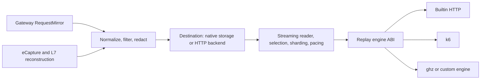

# Pluggable destinations and independent replayers

Kapture separates traffic acquisition, destinations, and replay execution. A
destination can be replaced without changing the eBPF collector, and a replay
engine can be replaced without knowing where captures are stored.
All replay paths preserve raw query strings, including older Mirror records that
keep the query separately in `metadata.query`.



The existing S3, GCS, EFS and EBS destinations remain available. `HTTP` adds an
out-of-process extension point for other stores, queues, and services through
the `kapture.backend.v1` protocol. It is an API for backend adapters; an arbitrary
webhook or Kafka broker does not speak it without an adapter.

## Backend authoring

The public SDKs have no dependency on Kapture's internal packages:

- `pkg/capture`: request records, opaque artifact metadata, read selection, reader.
- `pkg/backend`: capability descriptor, HTTP client and server, provider interfaces.
- `pkg/replayengine`: the existing independent replay engine ABI and SDK.

A provider implements `backend.Backend.Describe` and any of these interfaces:

| Capability | Provider interface | Consumer |
| --- | --- | --- |
| `requests.write` | `RequestSink.PutRequest` | Mirror and EBPF replay projections |
| `artifacts.write` | `ArtifactSink.PutArtifact` | L7 exchange JSON, checkpoints, PCAPNG, session manifests |
| `requests.read` | `ReplaySource.OpenReplay` | All existing replay engines through the host reader |

Serve it with `backend.NewHandler(provider)`, behind the provider's authentication
and TLS middleware. There is no Go shared-object requirement or compiler-version
coupling; other languages can implement the same HTTP protocol. Legacy `Plugin`
storage configuration remains supported for existing in-module Go plugins.
For an external Go adapter developed against this checkout, keep the existing
module import path and add a local replacement in the adapter's `go.mod`:

```go
replace github.com/kapture-io/kapture => /path/to/kapture
```

Capabilities are checked before use. A write-only backend works for Mirror.
EBPF requires evidence writing and rejects a request-only backend before probes
attach. A backend without reads cannot be used as a replay source. A queue adapter
can support writes alone or expose retained records through a reader.

Each successful write acknowledges durable acceptance, including any required
downstream persistence. The client does not automatically retry ambiguous writes.
Providers should deduplicate the stable capture/request identity and make artifact
PUTs idempotent. This contract does not provide exactly-once delivery.

Redaction happens in the capture pipeline before records or evidence reach the
destination. Authentication of that destination is separate from credentials
inside captured traffic. Payloads and evidence belong in object/file/queue
storage; SQL history receives artifact metadata and locations only.
History accepts destinations without a bucket. The existing SQL `s3_bucket`
column holds an empty string for these artifacts; no history schema migration
is needed.

## HTTP v1 wire protocol

`endpoint` is the base URL preceding `/v1/...`; a deployment prefix is allowed.
IDs and artifact names in paths are UTF-8 encoded with unpadded base64url, so
capture identities such as `app/orders` remain one path component.

| Method and path | Request | Successful response |
| --- | --- | --- |
| `GET /v1/capabilities` | None | Descriptor with `version`, `name`, `capabilities` |
| `POST /v1/captures/{id}/requests` | Existing captured-request JSON | 2xx durable acknowledgement |
| `PUT /v1/captures/{id}/artifacts/{name}` | Opaque bytes and original Content-Type | Artifact metadata with matching SHA-256 and byte size |
| `GET /v1/captures/{id}/requests?options={JSON}` | URL-encoded `capture.ReadOptions` | Incremental NDJSON frames |

Clients send `Kapture-Backend-Version: kapture.backend.v1` and, when configured,
`Authorization: Bearer <token>`. Redirects are rejected. Endpoint URLs cannot
contain embedded credentials, a query, or a fragment. Error response bodies are
not copied into agent logs or Kubernetes status because a service could echo
captured secrets into them.

Replay frames have exactly one variant:

```jsonl
{"request":{"id":"r1","timestamp":"2026-10-17T12:00:00Z","method":"GET","path":"/orders?q=1","protocol":"HTTP"}}
{"end":true,"count":1}
```

The terminal count covers the emitted selection. A source error emits
`{"error":"backend_read_failed"}`. EOF before a matching terminal frame fails
the replay instead of silently treating a disconnected stream as an exhausted
dataset. Cancellation closes blocked reads. Transport backpressure stops the
reader from fetching the entire capture while a replay engine is slow.

The SDK server reapplies time/path/method filters and the limit. Providers may
push selection down to storage, applying filters before a limit. Time ranges
use an inclusive start and exclusive end. Sources should yield chronological
records for original-timing replay. Individual request JSON is capped at 96 MiB
and evidence uploads at 256 MiB; these are transport ceilings, separate from
the collector's lower body and memory budgets. Control responses are bounded.

## Run the persistent reference backend

The reference provider uses a private, immutable per-record filesystem layout,
not Kapture's native JSONL.gz layout. Requests are streamed in timestamp order;
directory listings remain in memory, so this is a reference for adapter authors
rather than an indexed backend for arbitrarily large datasets.

```bash
go run ./cmd/backend-server --addr 127.0.0.1:9080 --data-dir /tmp/kapture-backend
```

Non-loopback listeners require `BACKEND_TOKEN`. The reference command serves
HTTP; terminate HTTPS at your ingress or wrap the SDK handler in a TLS server.
The reference store writes private files, syncs uploads, atomically publishes
them, deduplicates exact retries, and rejects conflicting immutable objects.

Select the same backend independently for capture and replay:

```bash
BACKEND_URL=http://127.0.0.1:9080 \
  go run ./cmd/capture-agent --storage-type http --capture-id app/orders

go run ./cmd/replay-engine --storage-type http \
  --backend-url http://127.0.0.1:9080 --capture-id app/orders \
  --target-url http://127.0.0.1:8080 --rate-mode original --time-scale 0.5
```

The capture command uses the default Mirror sink. EBPF uses the same destination
with the existing `--backend EBPF` and process-selection flags. Standalone
authenticated clients read `BACKEND_TOKEN` from the environment.

## Kubernetes configuration

```yaml
apiVersion: capture.gateway.io/v1alpha1
kind: CaptureStorage
metadata:
  name: external-destination
  namespace: app
spec:
  type: HTTP
  http:
    endpoint: https://capture-backend.example.com
    tokenSecretRef:
      name: capture-backend-auth
      key: token
```

Reference this storage from TrafficCapture and TrafficReplay as usual. The spoke
wires the endpoint and a namespace-local Secret reference into both workloads.
No token value is placed in a CRD, command argument, replay feed, or engine
subprocess environment. A storage `Ready` condition validates configuration;
the runtime checks reachability, authentication, and actual backend capabilities.
Upgrade the generated CRDs before using the additive `HTTP` type.

## Choosing a different replay strategy

The same HTTP reader feeds builtin HTTP replay, k6, ghz, or a custom
`kapture-engine-<name>` binary. Select `spec.engine.name` and `spec.engine.config`
on TrafficReplay or CaptureLoadTest. Storage access, secrets, filtering, sharding,
and host pacing stay outside that engine.

The builtin engine preserves each request. k6 supplies its VU execution model;
ghz replays the observed gRPC method mix with representative payloads. Engines
can be host-paced or advertise `self-paced`, and must reject unsupported rate
modes. See [replay engine ABI](replay-engine-abi.md) for packaging and semantics.

The current replay ABI feeds request records. Opaque evidence preserves responses,
HPACK state and richer L7 information, but does not automatically add stateful
conversation replay, streaming gRPC replay, or packet replay to an engine.

```bash
go test ./pkg/backend/... ./internal/ebpf ./internal/storage ./internal/plugin/replay ./internal/replayengine -race
```

The end-to-end test captures recorded L7 observations into an authenticated HTTP
destination, persists evidence in its independent layout, streams replay records
back, and sends them through an actual replay-engine subprocess to a local target.
It verifies body/query fidelity, redaction, terminal-stream checks, and separation
of destination credentials from the replay engine. Native BPF attachment is a
separate test.
