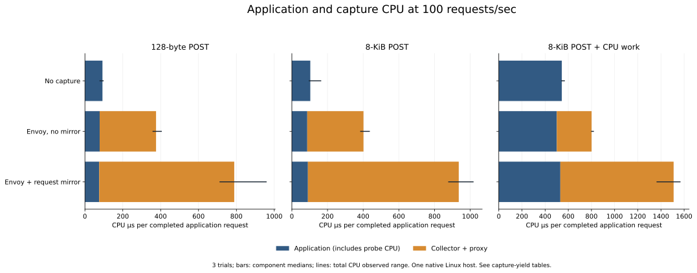

# Measured application overhead, 2026-10-19

This dataset measures **no capture, one Envoy proxy, and Envoy with 100% request
mirroring into Kapture** on the same native Linux host. There are **no eBPF or
Rust application-overhead measurements yet**: this workspace lacks kernel BTF,
and GitHub has not assigned a runner to the full experiment.

Across 54 trials, all **1,608,258 application requests** succeeded, with no missed
scheduled arrivals. All measured mirrored requests passed exact unique-ID, body
and redaction checks, including the saturation trials.

The incremental cost of enabling mirroring on an existing Envoy path was:

| Workload | Extra CPU µs/request, median (range) | Paired saturation throughput change, median (range) |
| --- | ---: | ---: |
| 128-byte POST | 385 (338–598) | -25.5% (-34.4% to -23.7%) |
| 8-KiB POST | 534 (494–582) | -45.0% (-47.0% to -36.2%) |
| 8-KiB POST plus CPU work | 687 (565–748) | +0.9% (+0.6% to +5.7%) |

Extra CPU sums application, proxy and collector time at a fixed offered load of
100 requests/sec. It corresponds to approximately 38–69 additional millicores
at that load. The positive CPU-work throughput difference is small relative to
shared-host variation and does not establish a mirroring speedup. Saturation is
a separate closed-loop experiment with 16 persistent client workers. Three
repeats and observed ranges are descriptive, not confidence intervals.

The [full report](report.md) includes fixed-load p50/p95/p99 data in the raw
tables, application CPU separately from proxy/capture CPU, anonymous memory,
no-capture comparisons, and incremental mirroring comparisons.



The configuration is HTTP/1.1 over TLS 1.3, with AES-128-GCM on the application
leg. All observed client-side cipher suites also matched AES-128-GCM. Profiles
use deterministic compressible bodies; the CPU-work variant performs 64 extra
SHA256 body passes. Each trial has a separate one-second warmup load process
and six-second measurement process. Measurement clients open fresh connections;
Envoy can reuse its warm upstream pool. Connection startup is included and
amortized. This setup does not establish full-mesh, remote-store, HTTP/2/gRPC,
steady-state memory, or production tail-latency costs.

## Raw data and provenance

- [trials.csv](trials.csv): flattened application/capture/resource measurements.
- [trials.jsonl.gz](trials.jsonl.gz): complete rows, including capture counters,
  exact matched-ID sums and Envoy counters.
- [metadata.json](metadata.json): host, CPU placement, limits, versions,
  canonical source revision and binary SHA256 hashes.
- [analysis.json](analysis.json): paired medians and observed ranges.
- [measured-runner.patch](measured-runner.patch): exact workspace accounting
  changes applied to the recorded source revision when these trials ran.

The measured source revision is `de8e87a888448d0be341ab417919d3d334fcd306` plus
the supplied runner patch. Reconstructed source was checked against the recorded
`runner_file_sha256`. Application and collector source files match that revision.
CPU uses Linux process CPU clocks with nanosecond resolution, including exited
worker threads and producer children; memory is sampled `RssAnon`/RSS. The
load-generator clock becomes unavailable after exit: those fields are normalized
to null and excluded from all app/capture totals. Metadata records this exact
normalization and the original raw-file checksum. Application, proxy and
collector measurements are unmodified. Fixture keys and capture payload files
were removed after measurement.

Regenerate the tables and figure (Python and optional matplotlib):

```sh
python3 tools/analyze-overhead.py docs/benchmarks/2026-10-19-application-overhead \
  --output /tmp/kapture-impact-report --plot
```

## Native eBPF/Rust comparison

The [benchmark instructions](../../../tools/overhead/README.md) and
[native workflow](../../../.github/workflows/overhead.yaml) cover seven modes
and 126 trials on a BPF-capable host. Native CI requires kernel BTF, root/BPF
permissions and writable cgroup v2. It automatically publishes raw data and
paired-baseline analysis when a runner becomes available. Rust FlowScope uses
the same TLS plaintext acquisition feed as Go, with its adapter and IPC included.

Actual BPF functionality passed separately on Linux 6.1: SSL BIO traffic,
worker-thread `_ex` traffic, and persistent-connection Go/Rust/export adapters.
Each adapter reconstructed all 20 test exchanges without invalid or duplicate
IDs. Software-emulation timing from those functional tests is excluded here.
