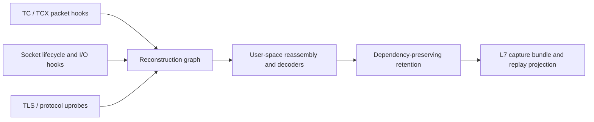

# Loom: eBPF L7 Capture — Design Proposal

**Status:** Proposed; no eBPF backend is implemented by this document.

**Date:** 2026-10-17

**Target:** An optional Linux capture backend for reconstructing HTTP and gRPC
exchanges with byte provenance, decoder state, and explicit completeness.

## Motivation

Kapture currently records requests delivered to capture agents through Gateway
API `RequestMirror` filters. A host-based eBPF backend could extend coverage to
traffic outside mirrored routes and observe both directions of an exchange,
including backend responses. It would require node-level privileges and
runtime-specific support for encrypted traffic.

The proposed scheme, codenamed Loom, records a graph of observed byte spans,
connection identities, and protocol dependencies. A selected L7 exchange is
exported with enough evidence to explain and reproduce its reconstruction.
Capture selection, retention, and reconstruction use the same graph.

The proposed differentiator is dependency-preserving retention with explicit
fidelity reporting. TLS plaintext capture and protocol tracing are established
techniques; this proposal makes no first-of-its-kind or patent novelty claim.

## Architecture



Keep kernel programs responsible for bounded copying, identities, counters,
and lightweight filtering. Perform stream reassembly, decompression, protocol
decoding, dependency tracking, and artifact construction in user space.

### Capture planes

| Plane | Mechanism | Evidence |
| --- | --- | --- |
| Transport | TC/TCX ingress and egress | Observed packet bytes, TCP sequence ranges, flags, ACKs, retransmissions, and timestamps |
| Socket | Lifecycle tracepoints and selected fentry/fexit probes | Socket identity, namespace/cgroup, operation actor, accepted/consumed byte counts, and close/reset events |
| Plaintext | Version-matched TLS library/runtime uprobes | Application plaintext before encryption or after decryption |
| Semantic, optional | Protocol-library USDT/uprobe adapters | Decoded headers, stream IDs, and framing events where byte-level decoder state is unavailable |

Record the capture point, interface, and available offload metadata. An skb
observed around GRO/GSO or TLS offload is not necessarily a physical wire frame.
Do not present skb boundaries as original network segmentation.

For TLS writes, snapshot input at entry and reconcile it with the API's actual
result; for reads, capture returned bytes after completion. Account for partial
writes, retries, nested wrappers, `_ex` output lengths, and non-consuming peek
operations. Distinguish attempted plaintext, API-accepted plaintext, transport
bytes, and local application consumption. An accepted write does not establish
peer application delivery. See [OpenSSL write semantics](https://docs.openssl.org/3.2/man3/SSL_write/).

OpenSSL, Go TLS, custom BIOs, asynchronous I/O, and kTLS require distinct
adapters. CO-RE can accommodate kernel layout differences; it does not make
arbitrary user-space ABIs or kernel hook semantics interchangeable. Unsupported
adapters must report their coverage limits. Ciphertext remains opaque without
usable plaintext observations or decryption secrets and sufficient context.

## Identity and observation model

For TCP, use a connection identity based on:

```text
connection = host_boot_id + network_namespace + socket_cookie
tls_object = process_start_id + object_address + allocation_generation
```

Track socket and TLS-object lifetimes, FD reuse, and socket sharing explicitly.
Keep the process performing an operation distinct from the process that opened
the socket. A five-tuple is an observation attribute, not a durable identity.

Bind TLS objects to sockets through observed FD/BIO associations or validated
runtime-specific data flow. Nested TLS-to-socket calls can establish a binding
for supported synchronous paths; they do not cover arbitrary custom BIOs or
cross-thread asynchronous transport. Packet observations without a resolvable
socket remain unbound. Do not attribute ingress packets to the currently
executing task merely because its PID is available.

Each observation becomes a span, conceptually:

```text
Span {
  capture_epoch, producer_id, producer_sequence,
  connection_id?, object_epoch?, operation_id,
  layer, direction,
  position_kind, position?, observed_length, captured_length,
  timestamp_start, timestamp_end,
  payload_reference, flags, binding_references
}
```

Positions are layer-specific: TCP sequence ranges, validated plaintext offsets,
or protocol stream offsets. Assign plaintext offsets only when a supported
adapter establishes ordering at the serialization point. Otherwise preserve
operations and their partial order. Neither timestamps nor ring-buffer arrival
order alone establish stream order. Identical content alone does not identify
a duplicate.

Use bounded payload chunks with explicit original lengths, chunk offsets, and
copy/truncation status. Preserve empty data separately from unavailable data.

## Reconstruction graph

Build nodes for connections, spans, TLS records where available, protocol
frames, decoder checkpoints, and application messages. Edges represent source
containment, transformations, identity bindings, or uncertain associations.

```text
gRPC message
    <- HTTP/2 DATA frame ranges
    <- TLS plaintext spans
    <- TLS records, when record lineage is established
    <- TCP sequence ranges
    <- observed packets
```

Reassembly proceeds as follows:

1. Resolve object lifetimes and connection bindings.
2. Reassemble TCP ranges, handle retransmissions and sequence wrap, and retain
   gaps. Conflicting overlaps need endpoint-consumption evidence or an explicit
   ambiguity result; do not silently choose a payload and call it exact.
3. Select available plaintext evidence or decrypt supported captured TLS
   records. Preserve the distinction between plaintext recovery and packet
   attribution.
4. Decode protocol framing incrementally. HTTP/1.1 requires message framing
   and request/response ordering; HTTP/2 requires directional HPACK state and
   per-stream reconstruction. gRPC requires message-envelope reassembly across
   DATA frames, trailers, and supported compression handling. Named protobuf
   fields require descriptors; raw gRPC message capture does not.
5. Materialize exchanges with source references and independent fidelity
   dimensions for bytes, decoder state, identity, and packet attribution.

TLS buffering creates many-to-many relationships between application calls,
records, and packets. Plaintext probes do not automatically establish exact
ciphertext packet ranges. Exact links require additional record instrumentation
or validated decryption of the captured records; otherwise expose the association
as uncertain. An exact application message can have uncertain packet attribution.

Scope timing claims to their observation layer. TLS API timing, TCP timing, and
remote application processing time are different measurements.

## Dependency-preserving retention

Continuously decode protocol framing and state changes, retain a bounded payload
history, and checkpoint decoder state at safe boundaries. For HTTP/2, checkpoints
include directional HPACK tables, settings, parser position, and relevant stream
state. Store decoder/schema versions and source references with each checkpoint.

When a request matches an error, latency, or user filter, retain:

```text
capture(exchange) =
    selected payload spans
  + decoder checkpoint and required subsequent state transitions
  + connection bindings and provenance
```

Walk the dependency graph backwards from the selected exchange to a valid
checkpoint, pin the required nodes, and expire unrelated payloads. Shared
dependencies are retained once and referenced by multiple exchanges. Apply
byte/time budgets to pinned data too; an exhausted budget produces an explicit
incomplete capture rather than unbounded memory growth.

For example, HTTP/2 stream 41 fails with a gRPC error. Its headers refer to an
HPACK entry introduced by stream 17. Retain the necessary table state, subsequent
header/control transitions, selected DATA spans, and trailers. Unrelated DATA
bodies may expire if their frame boundaries and lengths are known and no selected
decoder depends on their contents.

Starting midway through a connection can leave HPACK headers undecodable.
Supported protocol-library probes may recover subsequent decoded headers, but
that does not recover the original encoded bytes or earlier messages. See
[Pixie's HTTP/2 tracing explanation](https://blog.px.dev/ebpf-http2-tracing/).

Checkpoints preserve state observed by the recorder; they cannot recreate bytes
it never captured. A later trigger cannot retrieve an already-expired body.
Stateful body decompression needs its own valid checkpoint or retained prefix;
an HPACK snapshot is insufficient. Continuous parsing has a processing cost:
this retention scheme primarily reduces persisted data, not payload-copy cost.

## Loss and completeness

Distinguish intentional omission, configured truncation, failed memory reads,
unknown event loss, late attachment, state eviction, and unsupported decoding.

Allocate producer sequence numbers before attempted export. Maintain cumulative
loss counters and capture epochs independently of the event channel, reconcile
them periodically, and report close/restart intervals without trustworthy final
watermarks as uncertain. Ring-buffer reservation can fail, so a loss notification
sent only through that same buffer is insufficient. See
[Linux BPF ring-buffer documentation](https://kernel.org/doc/html/latest/bpf/ringbuf.html).

If loss scope cannot be assigned to a particular connection, conservatively
invalidate completeness for the affected producer interval. Map eviction and
metadata loss must not silently reset an active connection to a clean state.

A known omitted HTTP/2 DATA body can be skipped when framing is intact. An unknown
gap in a header block may invalidate subsequent HPACK decoding. Propagate missing
state to dependent messages until a valid recovery point is established. Never
fill missing bytes with guesses and label the result complete.

## Capture artifacts

Export a versioned bundle with checksums and references between artifacts:

| Artifact | Contents |
| --- | --- |
| `wire.pcapng`, when enabled | Packets as observed at the declared hook, with capture-point metadata |
| L7 JSONL and byte blobs | Requests/responses, headers/trailers, bodies, stream IDs, source references, and fidelity fields |
| Decoder checkpoints | State and versions required for independent reconstruction |
| Bundle manifest | Object locations, sizes, checksums, capture epochs, gaps, and dependency references |
| Replay projection | Compatible request records selected for Kapture replay |

Where policy permits secrets export and sufficient packet context exists, embed
usable TLS key-log material in PCAPNG decryption-secrets blocks for ordinary
Wireshark decryption. See [Wireshark TLS support](https://wiki.wireshark.org/TLS/).

An optional synthetic plaintext PCAP is a compatibility view and must be labeled
as reconstructed. It must not reuse ciphertext sequence numbers as if plaintext
had the same transport layout. Stock Wireshark does not consume arbitrary Loom
decoder snapshots: native checkpoint replay needs an integration, while standalone
PCAP export needs retained protocol history or a clearly synthetic bootstrap.

## Integration with Kapture

Add the backend incrementally while preserving Gateway mirroring as the default.
The following are implementation directions, not existing CRD fields or commands.

| Existing component | Proposed integration |
| --- | --- |
| [TrafficCapture API](../../api/v1alpha1/trafficcapture_types.go) | Introduce an explicit backend choice and workload/node scope through a separately reviewed, backward-compatible API change. Route-based mirror semantics remain the default. |
| [Spoke controller](../../internal/spoke/controller.go) | Reconcile node-agent sessions, capability reports, filters, bounded retention, and teardown for eBPF captures. Do not inject mirror filters for an eBPF session. |
| [Capture handler](../../internal/agent/handler.go) | Reuse or extract filtering, limits, redaction, and normalization. Preserve observed timestamps and stable IDs; the current mirror handler assigns a new ID and current time. |
| [Storage interfaces](../../internal/storage/interface.go) | Use `storage.Writer` for compatible `CapturedRequest` projections. Introduce a separate artifact-upload interface for packets, blobs, responses, and checkpoints; `Writer` currently accepts request records only. |
| [Dataset manifest](../../internal/dataset/manifest.go) | Keep the existing request-dataset manifest compatible. Version the richer bundle manifest independently; do not reinterpret existing request counts or checksums. |
| [Capture history](../capture-history-rds.md) | Store status, capability/quality summaries, and artifact locations in history. Keep payloads, packet data, secrets, and checkpoints in object/file storage. |
| [Replay ABI](../replay-engine-abi.md) | Export supported, sufficiently complete requests into the existing replay path. Keep rich response/evidence data alongside that projection. |

A per-node collector should report kernel/runtime capabilities before a session
is considered ready. Kubernetes desired state remains authoritative; controllers
must reconcile sessions idempotently and detach their probes on teardown. Shared
node instrumentation must be reference-counted across concurrent capture sessions.

Honor existing header redaction and payload-processing policy across every durable
artifact, not just the semantic projection. Byte-exact evidence may contain the
same credentials that a normalized view removes. Omit incompatible evidence or
provide an explicitly redacted derivative with changed fidelity. Raw evidence and
decryption-secret persistence require a defined policy before implementation.

Initially, only complete supported requests should enter the replay projection.
Keep partial exchanges in the inspection bundle. Preserve captured body bytes and
observation timestamps without inventing missing headers or bodies. Generic gRPC
stream replay and response validation need separate engine capabilities.

## Implementation and validation plan

1. Define the versioned span, gap, binding, and bundle schemas. Implement
   deterministic user-space reconstruction from fixtures before attaching live
   probes. Establish the redaction/export policy and replay eligibility rules.
2. Add TCP identity and bounded packet/plaintext collection for a pinned OpenSSL
   adapter and HTTP/1.1. Verify retry, partial-I/O, ordering, and lifecycle behavior.
3. Add HTTP/2 and gRPC framing, directional HPACK checkpoints, and dependency
   retention. Validate selected-exchange replay after unrelated bodies expire.
4. Add object/file bundle upload and request projection, then integrate node
   sessions into spoke reconciliation and status. Add API/chart generation and
   controller/e2e checks when those components change.
5. Add further runtime adapters and a separate QUIC backend. QUIC needs logical
   connection identity across CID/path changes plus stream IDs and offsets; a
   UDP socket cookie alone is insufficient.

Compare reconstruction with controlled endpoint transcripts and independently
captured packet evidence. Exercise FD/TLS-object reuse, shared sockets, concurrent
I/O, custom BIOs, fragmentation, retransmissions, conflicting overlaps, ring-buffer
overflow, metadata loss, late attachment, parser eviction, and agent restart.

Acceptance requires correct fields and body bytes for complete supported captures,
explicit taint for missing dependencies, and no false claim of exact packet
attribution. Measure CPU, payload-copy volume, event loss, memory, retained bytes,
and reconstruction latency under stated workload/kernel/runtime versions. No
throughput or overhead result is claimed by this proposal.

## Related work

[eCapture](https://github.com/gojue/ecapture) already provides TLS plaintext,
key-log, and PCAPNG capture. [Pixie](https://blog.px.dev/ebpf-tls-tracing-past-present-future/)
documents TLS tracing and connection-association challenges. Loom builds on these
established observation techniques and proposes a shared dependency graph for
reconstruction, retention, and fidelity reporting. A separate prior-art review
would be needed to assess novelty beyond this design proposal.
